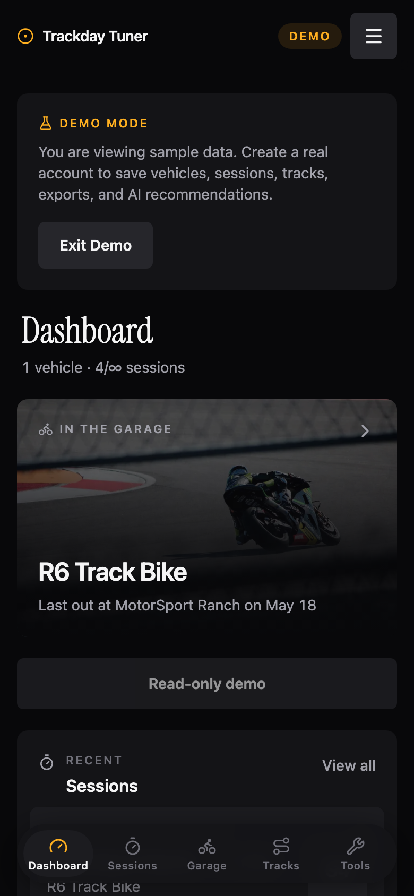
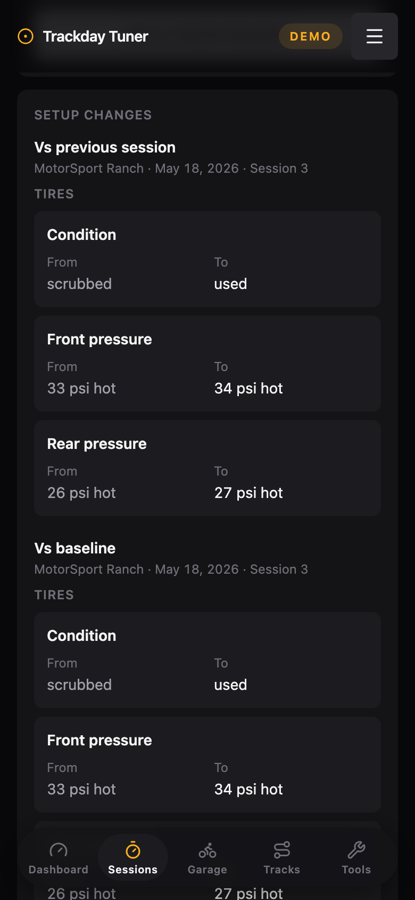
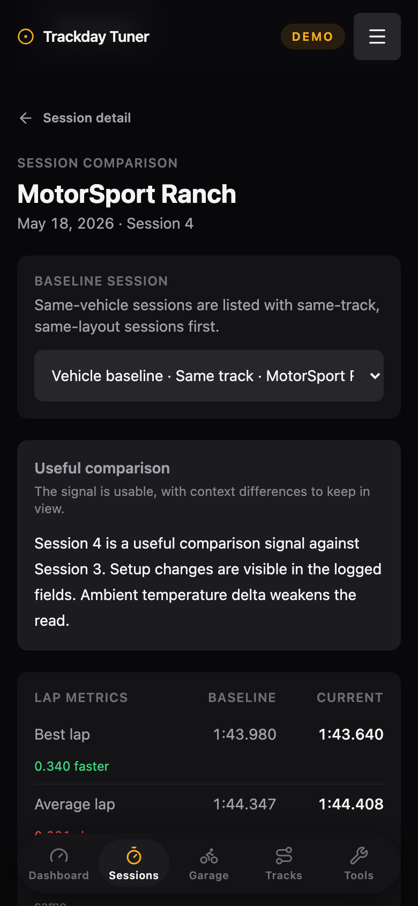
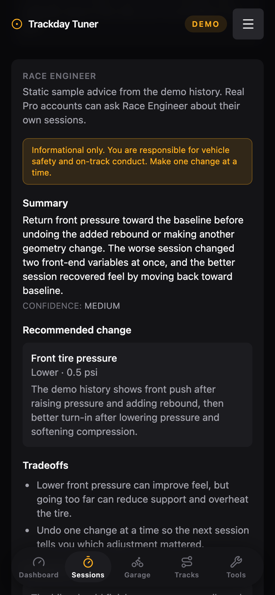
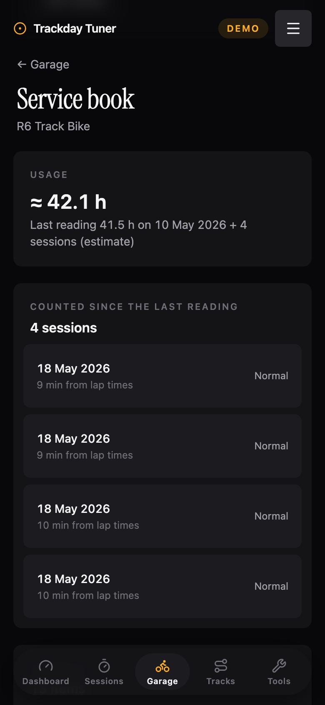
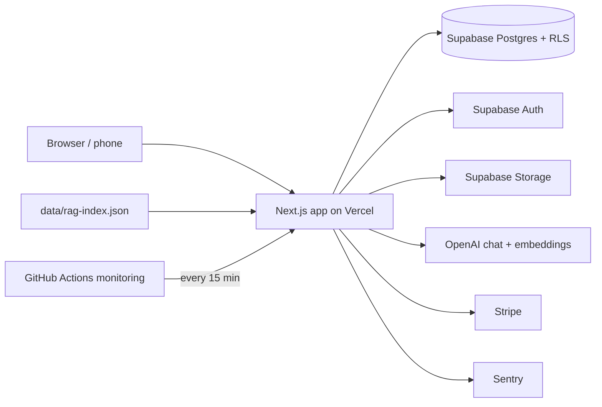

# Track Tuner

Track Tuner is a mobile-first web app for motorcycle and car track days. A rider
logs each session's setup (tires, suspension, geometry, drivetrain), conditions
and lap times, compares sessions to see what changed, and can ask an AI "Race
Engineer" for a setup change grounded in their own logged sessions and a curated
knowledge base. The app's header reads "Trackday Tuner".

**Live app:** https://trackday-tuner.vercel.app

**Try it without an account:** open https://trackday-tuner.vercel.app/demo (or
"Explore the demo" on the landing page). It sets a demo cookie and opens a
read-only tour of sample data: one bike, four sessions at one track, a Race
Engineer answer and a service book. Nothing can be saved in demo mode, and
"Exit Demo" leaves it.

<table>
  <tr>
    <td></td>
    <td></td>
    <td></td>
    <td></td>
    <td></td>
  </tr>
  <tr>
    <td>Dashboard</td>
    <td>Setup changes</td>
    <td>Comparison</td>
    <td>Race Engineer</td>
    <td>Service book</td>
  </tr>
</table>

Screenshots are from the demo on the live app, at phone width.

## What it does

### Trackside logging and comparison

- Sessions for motorcycles and cars, with setup modules a rider adds only where
  they have data, lap times, weather and track temperature, and photos.
  Answers a rider did not give stay empty: the weather row opens with nothing
  selected and a save is refused until one is chosen
  (`lib/session-answers.ts`, `components/ui/choice-row.tsx`).
- A session is written by one Postgres function, `create_session_with_laps`, so
  the row, laps and conditions save together or not at all. The same path
  serves the website form and a bearer-authenticated mobile endpoint
  (`POST /api/mobile/sessions`), is idempotent on a client-minted id, and
  enforces the free-plan session cap under a per-rider lock
  (`lib/sessions/create.ts`).
- Each session shows its setup changes against the previous session and against
  a rider-chosen vehicle baseline, and a comparison page sets lap metrics and
  setup deltas side by side with flags for context differences such as ambient
  temperature (`lib/session-compare.ts`).
- North American circuits and their layouts are seeded by a migration, with
  aliases, so typed track names resolve to one circuit
  (`lib/track-lookup.ts`, `CONTEXT.md`).

### Race Engineer (AI setup advice)

- `POST /api/ai/tuning-advice` and `POST /api/ai/day-plan` (both Pro
  features) build a prompt from the rider's own data: the current and
  previous session, similar past sessions, recorded outcomes, earlier
  recommendations and a per-vehicle memory. They add knowledge-base passages retrieved by embedding
  similarity from `docs/knowledge-base/` (16 documents, 80 chunks in
  `data/rag-index.json`). The model is OpenAI `gpt-5.4-mini` with
  `text-embedding-3-small` embeddings (`lib/rag/`).
- The model must answer in a fixed JSON shape, and `evaluateAdvicePolicy`
  (`lib/rag/policy.ts`) checks each answer before a rider sees it: every
  recommended change must use a component and direction from a closed
  vocabulary, stay under a per-component magnitude ceiling, cite a document that
  was actually retrieved, and reference only session ids the prompt contained.
  An answer that breaks these rules is withheld and the rider gets a refusal
  instead; a single unverifiable session citation is dropped with a notice
  rather than discarding the answer. The same vocabulary file
  generates the part of the system prompt that tells the model those words
  (`lib/rag/component-vocabulary.ts`).
- Request-side guards (`lib/rag/domain-guard.ts`, `lib/rag/premise-guard.ts`):
  - a prompt-injection screen over the submitted question and, separately, over
    text the rider stored earlier that the prompt prints (notes, nicknames,
    setup strings);
  - an off-topic screen on Race Engineer questions that refuses requests
    outside vehicle setup;
  - a dangerous-action premise guard (removing or disabling named brake
    hardware) and a dangerous-value premise guard (a tire pressure above the
    highest figure any cited tire maker publishes for that vehicle type, from
    `docs/knowledge-base/tires/pressure-limits.md`). These reject the premise
    with a warning and still answer the underlying question.
  - a per-rider rate limit and an `ai_requests` audit row for every request.
- Known gaps in the guards are recorded rather than hidden: the uncovered
  phrasings and known false positives are pinned as test cases in
  `lib/rag/premise-guard.test.ts` and listed under `limitations` in
  `eval-baseline.json`.

### RAG evaluation harness

- `npm run rag:eval` runs 33 golden cases
  (`tests/fixtures/rag-eval/golden-cases.json`) through the production prompt
  builder, retrieval, model call and policy, and scores rubric pass rate,
  refusal accuracy, recall@k, MRR and component and direction accuracy.
- Offline mode replays committed OpenAI responses keyed by a hash of each
  request, so it needs no API key and any prompt change shows up as a named
  miss. `--live` re-records against the real API.
- CI fails when a gated metric, or any single case, regresses against the
  committed `eval-baseline.json`. Each run also scores three known-bad responses
  and fails if any of them passes, so the scorer is shown to be able to fail.

### Service book

- A maintenance record per vehicle (`/garage/[id]/book`): service items with a
  due state computed from odometer or hour readings and logged sessions,
  entries, receipts and photos in a private storage bucket, and in-app
  reminders on the garage, dashboard and session pages
  (`lib/service-book/`).
- History is kept honest in the database: every change to an entry writes a
  revision from a trigger that no API role can edit, entries are soft-deleted
  rather than removed, and the server-set `logged_at` beside the rider-typed
  service date is what labels an entry as back-filled. "Edited" is counted
  from the revisions.
- An owner can share a book through a read-only link (only a SHA-256 hash of
  the token is stored) and download it as a PDF, either a summary or the full
  file with photos (`lib/service-book-pdf.ts`).

### Production monitoring

- `GET /api/health` checks the database, that the RAG index is in the deployed
  bundle, that every RPC the app calls still resolves through the Data API,
  AI question-text retention and the attachment sweep
  (`lib/monitoring/health.ts`).
- A scheduled GitHub Actions workflow (`.github/workflows/monitoring.yml`)
  probes `/api/health` and `/api/monitoring/ai-health` (AI error rate and p95
  latency over the last hour) every 15 minutes and runs the attachment cleanup.
  Handled errors are reported to Sentry through `reportError`
  (`lib/monitoring/report-error.ts`). See `docs/monitoring.md`.

## Architecture

- **Next.js 16** App Router with React 19 and TypeScript (strict). Server
  components and server actions for most reads and writes, route handlers for
  the AI, Stripe, mobile and monitoring endpoints. Tailwind CSS v4.
- **Supabase**: Postgres with row-level security on rider data, Auth
  (email/password and OAuth), and Storage. Grants to the Data API roles are
  made per table and per function. Schema changes are SQL migrations in
  `supabase/migrations/`; nothing applies them on deploy, so they are applied
  by an operator (`npm run db:push`, or by hand from `docs/beta-runbook.md`),
  and `/api/health` reports a deployment whose database is missing an RPC.
- **OpenAI** for chat completions and embeddings. The retrieval index is built
  offline from `docs/knowledge-base/` and shipped in the bundle.
- **Stripe** for the Pro subscription (checkout, customer portal, webhook).
- **Vercel** for hosting; GitHub Actions for CI and the monitoring probe;
  Sentry for errors.



## Running it locally

Requires Node 22.18 or later (CI uses Node 24) and Docker.

```bash
npm install
npx supabase start
cp .env.example .env.local
```

`npx supabase start` builds a local database from every migration and creates
the storage buckets. Fill `NEXT_PUBLIC_SUPABASE_URL`,
`NEXT_PUBLIC_SUPABASE_ANON_KEY` and `SUPABASE_SERVICE_ROLE_KEY` in `.env.local`
from `npx supabase status -o env`, and set `BETA_INVITE_ONLY=false` so signup is
open. Then:

```bash
npm run dev
```

and open http://127.0.0.1:3000. Email confirmation is off locally, so signing up
logs you straight in, and `/demo` works without signing up. The AI routes need
`OPENAI_API_KEY` and billing needs the Stripe keys listed in `.env.example`.

[docs/local-development.md](docs/local-development.md) has the full setup:
password-recovery mail, storage buckets, rebuilding the database and lint
configuration.

## Tests

```bash
npm run lint          # ESLint
npm run test:unit     # Vitest unit suite
npm run rag:eval      # RAG eval, offline replay (no API key needed)
npm run build         # production build
npx tsc --noEmit      # type check (after a build, which generates route types)
npm run test:db       # Postgres behaviour against the local Supabase stack
npm run test:e2e      # Playwright browser specs; see TESTING.md
```

CI (`.github/workflows/ci.yml`) runs lint, the unit suite, the offline RAG eval,
the build and the type check on every pull request, and runs `test:db` and the
Playwright e2e suite against a fresh local Supabase stack, the e2e suite on a
production build of the app. [TESTING.md](TESTING.md) covers the environment
each suite needs.

## More documentation

- [docs/prd.md](docs/prd.md): the original product requirements document
- [CONTEXT.md](CONTEXT.md) and [docs/adr/](docs/adr/): domain glossary and decisions
- [docs/ai-mvp-spec.md](docs/ai-mvp-spec.md): the AI feature spec
- [docs/monitoring.md](docs/monitoring.md): monitoring runbook
- [docs/beta-runbook.md](docs/beta-runbook.md): operating the hosted project
- [CLAUDE.md](CLAUDE.md): engineering notes for contributors and coding agents
